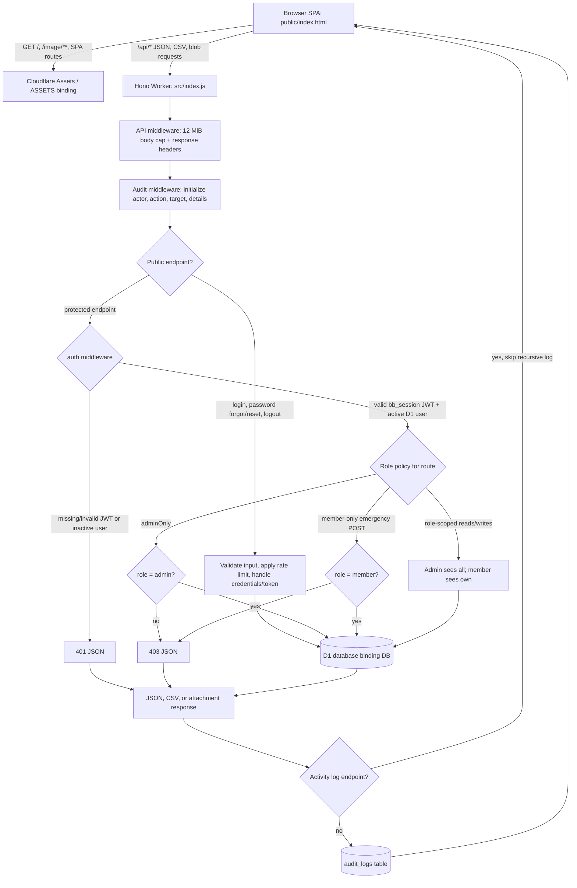
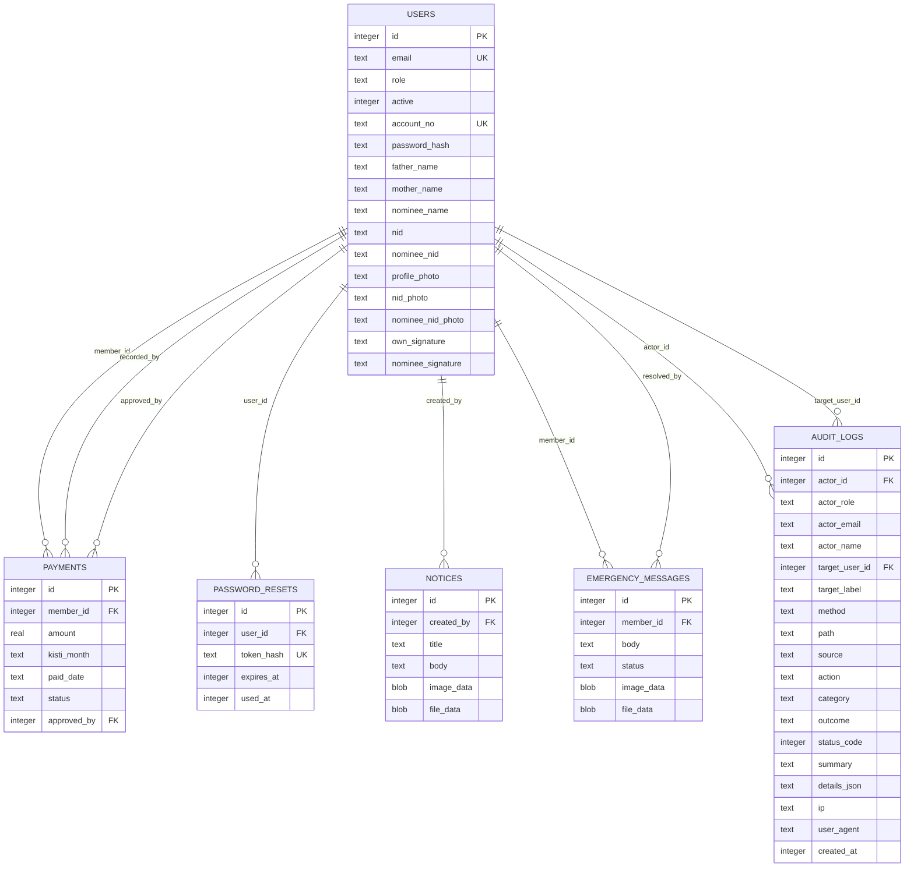

# BonDhu Bitto — Technical Architecture

## 1. Overview

BonDhu Bitto is a monthly savings and kisti management application for an administrator and community members. The current production path is a Cloudflare Worker built with Hono, backed by Cloudflare D1, with the browser UI and media served as static assets from the same Worker project.

A legacy Express/SQLite server remains in the repository for local and legacy use. It is not the deployment target configured for production, but it exposes nearly the same API and is useful for development, smoke testing, and migration comparison.

| Runtime | Entry point | Database | Static assets | Status |
| --- | --- | --- | --- | --- |
| Cloudflare Worker | `src/index.js` | D1 binding `DB` | `public/` through the `ASSETS` binding | Production path |
| Express | `server.js` | Local `data/bondhu-bitto.sqlite` via `better-sqlite3` | `public/` via `express.static` | Local/legacy path |

Important runtime differences:

- The Worker uses Web Crypto PBKDF2 password hashes and hides this detail in the Hono/JWT layer.
- The legacy server uses bcrypt, 12-hour JWTs, SMTP/Nodemailer recovery, and automatic local SQLite schema creation.
- Local SQLite data is not copied into D1 automatically.
- Both runtimes write an audit record for every `/api/*` request; the Worker adds route-specific metadata, while the legacy server records request-level detail with login/logout actor enrichment.
- There is no separate frontend build step: `public/index.html` is a single-file SPA containing its own CSS and JavaScript.
- The SPA includes lightweight client-only UI behavior such as the Community Promise hover zoom and a native `<dialog>` full-size image lightbox; neither requires an API or schema change.

## 2. Request Flow and Authorization

The production deployment serves ordinary browser requests from Cloudflare's static asset layer and routes `/api/*` to the Worker first (`run_worker_first = ["/api/*"]`). Unknown non-API paths are handled as single-page-application routes.



Authorization rules in `src/index.js`:

| Layer | Behavior |
| --- | --- |
| `auth` | Reads `bb_session`, verifies an HS256 JWT, reloads the user from D1, rejects missing/inactive users with `401`, and exposes the user via Hono context. |
| `adminOnly` | Requires `role === "admin"`; otherwise returns `403`. Applied to member administration, payment editing/approval/deletion, emergency inbox operations, notices creation/deletion, and reports. |
| Member-only check | `POST /api/emergency` explicitly rejects non-members with `403`. |
| Role-scoped access | `GET /api/payments` and `GET /api/dashboard` work for both roles but return different data; `POST /api/payments` lets an admin choose any active member while a member can only record for themselves. |
| Activity log access | `GET /api/activity-log` requires the `admin` role; non-admins receive `403` and no activity-log navigation is rendered. |
| Attachment access | Notice attachments are readable by any authenticated user; emergency attachments are admin-only. |

The UI mirrors these rules with `.adminnav` and `.membernav` classes, but server-side middleware and role checks remain the enforcement boundary.

## 3. File / Module Map

| Path | Responsibility |
| --- | --- |
| `src/index.js` | Complete Hono Worker: constants, validation, hashing, JWT sessions, rate limiting, admin bootstrap, every production API route, audit middleware/helpers, error handlers, and D1 queries. |
| `public/index.html` | Single-file SPA: login/recovery/reset views, role-aware navigation, dashboard, members, profile, kisti history, notices, emergency messages, activity log, reports, dialogs, all styling, and all client-side behavior. |
| `public/image/` | Static branding and media assets such as logos, videos, and community imagery. |
| `wrangler.toml` | Worker name, entry point, compatibility flags, asset binding and SPA behavior, D1 binding/migrations directory, non-secret variables, and observability. |
| `migrations/0001_init.sql` | Base D1 schema for `users`, `payments`, `password_resets`, `notices`, and `emergency_messages`, plus indexes. |
| `migrations/0002_audit_logs.sql` | Additive D1 schema for `audit_logs`, including actor, timestamp, action, outcome, detail, and lookup indexes. |
| `server.js` | Legacy Express/SQLite implementation; creates and migrates its local schema (including `audit_logs`) at startup and serves `public/` as static files. |
| `package.json` | Dependencies and scripts for legacy start/dev, Worker dev, build, deploy, and D1 migrations. |
| `.env.example` | Template for legacy server configuration; contains placeholders only. |
| `.dev.vars.example` | Template for local Worker development secrets and configuration; contains placeholders only. |
| `.notice-emergency-smoke.cjs` | Local smoke test that starts the Express server in a temporary directory and exercises notice/emergency flows. |
| `README.md` | Human-oriented setup, deployment, backup, and production-readiness notes. |
| `dist/` | Generated output of the Worker dry-run build; not application source. |

## 4. Data Model

The Worker schema is defined across `migrations/0001_init.sql` and `migrations/0002_audit_logs.sql`. The legacy server creates a compatible schema at startup, applies additive columns for older databases, and includes the same `audit_logs` table shape.



### 4.1 `users`

Stores both administrators and members.

| Column group | Important columns | Notes |
| --- | --- | --- |
| Identity | `id`, `name`, `email`, `phone`, `account_no` | `email` is unique with case-insensitive collation. `account_no` has a partial unique index when non-null; member creation generates `BB-` plus a zero-padded numeric ID. |
| Security | `password_hash`, `role`, `active` | `role` is constrained to `admin` or `member`. `active = 0` blocks login and authenticated requests. Hash values are either the current PBKDF2 envelope or legacy bcrypt. |
| Profile | `father_name`, `mother_name`, `nominee_name`, `nid`, `nominee_nid` | Text fields bounded by API validation; profile completion in the dashboard checks 13 identity/profile fields. |
| Images | `profile_photo`, `nid_photo`, `nominee_nid_photo`, `own_signature`, `nominee_signature` | `TEXT` columns holding JPEG data URLs, not file paths. Signatures may be uploaded or drawn in the browser canvas pads and exported to canonical JPEG client-side. |
| Audit | `created_at` | Creation timestamp. |

Relationships: one user has many payments as `member_id`, `recorded_by`, and `approved_by`; many notices as `created_by`; many emergency messages as `member_id` and `resolved_by`; many password-reset records as `user_id`; and many audit logs as `actor_id` or `target_user_id`.

### 4.2 `payments`

Stores kisti records and approval state.

| Column group | Important columns | Notes |
| --- | --- | --- |
| Money and period | `amount`, `kisti_month`, `paid_date` | `amount` is a positive `REAL`; month must be `YYYY-MM`; date must parse as `YYYY-MM-DD`; API caps amount at 100,000,000. |
| Attribution | `member_id`, `recorded_by`, `method`, `reference`, `note` | `member_id`, `recorded_by`, and `approved_by` reference users. Method defaults to `Cash`; reference and note are sanitized/truncated. |
| Approval | `status`, `approved_by`, `approved_at` | Status is `pending` or `approved`, defaulting to `approved` in the schema. Member submissions are created as `pending`; admin submissions are immediately `approved`. |
| Audit | `created_at` | Creation timestamp. |

Indexes exist on `member_id` and `kisti_month`. Approved totals drive dashboards, member totals, and CSV reports.

### 4.3 `password_resets`

| Column | Notes |
| --- | --- |
| `id`, `user_id` | `user_id` references `users(id)` with `ON DELETE CASCADE`. |
| `token_hash` | Unique SHA-256 digest of the raw token; the raw token is only sent in the email link. |
| `expires_at`, `created_at` | Millisecond epoch values; links expire after 30 minutes. |
| `used_at` | Present in the schema and checked by the lookup query, but the current implementation removes reset rows instead of setting this field. |

There is an index on `user_id`. A reset request deletes prior rows for that user and expired rows globally; a successful reset deletes all rows for that user.

### 4.4 `notices`

| Column group | Important columns | Notes |
| --- | --- | --- |
| Content | `title`, `body` | Required title; body may be empty if an attachment is supplied. |
| Image | `image_mime`, `image_data` | Image bytes stored as a D1 `BLOB`; served by `GET /api/notices/:id/image`. |
| File | `file_name`, `file_mime`, `file_data` | Attachment bytes stored as a D1 `BLOB`; filename is sanitized before storage. |
| Audit | `created_by`, `created_at` | `created_by` references the administrator who published the notice. |

The notice list query excludes blob payloads and exposes `has_image` / `has_file` flags.

### 4.5 `emergency_messages`

| Column group | Important columns | Notes |
| --- | --- | --- |
| Sender and content | `member_id`, `body` | Only `member` role accounts can create rows. |
| Attachments | `image_mime`, `image_data`, `file_name`, `file_mime`, `file_data` | Stored as D1 blobs and served only to administrators. |
| Workflow | `status`, `created_at`, `resolved_at`, `resolved_by` | Status is `new` or `resolved`; resolution records the admin and timestamp. |
| Reporting view | Joined member fields | Admin list joins `users` for member name, account number, email, and phone. |

An index on `(status, created_at)` supports the admin inbox ordering.

### 4.6 `audit_logs`

| Column group | Important columns | Notes |
| --- | --- | --- |
| Actor | `actor_id`, `actor_role`, `actor_email`, `actor_name` | Snapshot of the signed-in user at request time; `actor_id` may be null for public failures such as invalid login. |
| Target | `target_user_id`, `target_label` | Optional affected member/user and a human-readable target such as a member name, A/C number, payment id, or notice id. |
| Request | `method`, `path`, `source`, `ip`, `user_agent` | HTTP metadata from the audited request; `source` is `worker` or `legacy`. |
| Classification | `action`, `category`, `outcome`, `status_code` | Stable action key (`user.login`, `payment.approved`, etc.), UI category, `success`/`failure`/`error`, and HTTP status. |
| Detail | `summary`, `details_json` | Short human-readable summary plus escaped JSON metadata, capped at 8 KiB. Raw passwords, reset tokens, image payloads, and NID values are not stored. |
| Time | `created_at` | Millisecond epoch timestamp used for newest-first ordering and dashboard stats. |

Indexes cover `(actor_id, created_at)`, `(action, created_at)`, `(outcome, created_at)`, and `created_at`. The Worker writes enriched route-specific records; the legacy server writes comparable request-level records with login/logout actor snapshots. `GET /api/activity-log` is excluded from logging to avoid recursive entries.

## 5. API Surface

All endpoints are mounted under `/api` by both implementations. Responses are JSON except `GET /api/report.csv` and blob attachment routes. Access below refers to the production Worker behavior.

### 5.1 Authentication and Profile

| Method | Endpoint | Access | Purpose |
| --- | --- | --- | --- |
| `POST` | `/api/login` | Public; rate-limited | Normalize email, verify password, set `bb_session`, return the minimal signed-in user. |
| `POST` | `/api/password/forgot` | Public; rate-limited; configuration-dependent | Generate a reset token and send a link when mail delivery is configured. |
| `POST` | `/api/password/reset` | Public; rate-limited | Validate a 30-minute token, enforce password policy, replace the hash, and delete reset rows. |
| `POST` | `/api/logout` | Public client call | Clear the `bb_session` cookie. |
| `GET` | `/api/me` | Authenticated | Return the current user snapshot; also acts as the client's session heartbeat. |
| `GET` | `/api/profile` | Authenticated | Return the user's editable profile and image data URLs. |
| `PATCH` | `/api/profile` | Authenticated | Update name, family/nominee/NID fields, and optionally profile/NID/signature images. |

Signature images may arrive from a file upload or from the client-side drawing pads. Both paths send canonical JPEG data URLs and are validated by `parseProfileImage` (maximum 650 KiB decoded).

### 5.2 Members

| Method | Endpoint | Access | Purpose |
| --- | --- | --- | --- |
| `GET` | `/api/members` | Admin | List members with active state and approved total saved. |
| `POST` | `/api/members` | Admin | Create a member, hash the temporary password, and generate an account number. |
| `GET` | `/api/members/:id/profile` | Admin | Return one member's profile and images. |
| `PATCH` | `/api/members/:id/profile` | Admin | Update a member's contact/profile fields and optionally replace images. |
| `PATCH` | `/api/members/:id/status` | Admin | Activate or deactivate a member. |
| `POST` | `/api/members/:id/reset-password` | Admin | Replace a member's password hash, validate the new password, and delete outstanding reset tokens for that member. |
| `GET` | `/api/members/:id/ledger` | Admin | Return member details, all kisti records, approved total, and pending total. |

### 5.3 Payments / Kisti

| Method | Endpoint | Access | Purpose |
| --- | --- | --- | --- |
| `GET` | `/api/payments` | Authenticated | Return up to 500 joined payment rows: all rows for admin, only own rows for members. |
| `POST` | `/api/payments` | Authenticated | Create a payment. Admin chooses the member and gets `approved`; member submits for self and gets `pending`. |
| `POST` | `/api/payments/:id/approve` | Admin | Transition one pending payment to approved with approver and timestamp. |
| `PATCH` | `/api/payments/:id` | Admin | Edit member, amount, month, date, method, reference, and note. |
| `DELETE` | `/api/payments/:id` | Admin | Delete a payment record. |

### 5.4 Notices and Emergency Messages

| Method | Endpoint | Access | Purpose |
| --- | --- | --- | --- |
| `GET` | `/api/notices` | Authenticated | List notices with author and attachment-presence flags. |
| `POST` | `/api/notices` | Admin | Publish a notice with text and/or validated image/file attachment. |
| `GET` | `/api/notices/:id/image` | Authenticated | Stream a notice image with `private, no-store` caching and `nosniff`. |
| `GET` | `/api/notices/:id/file` | Authenticated | Stream a notice file as an attachment with a sanitized filename. |
| `DELETE` | `/api/notices/:id` | Admin | Delete a notice. |
| `POST` | `/api/emergency` | Member only; rate-limited | Send a message and optional attachments to the administrator. |
| `GET` | `/api/emergency` | Admin | List messages, newest `new` messages first, joined with sender details. |
| `GET` | `/api/emergency/:id/image` | Admin | Stream an emergency image. |
| `GET` | `/api/emergency/:id/file` | Admin | Stream an emergency file. |
| `PATCH` | `/api/emergency/:id/resolve` | Admin | Mark one new message as resolved with timestamp and resolver. |

### 5.5 Dashboard and Reports

| Method | Endpoint | Access | Purpose |
| --- | --- | --- | --- |
| `GET` | `/api/dashboard` | Authenticated | Role-specific totals, active member count, recent activity, and profile completion for admins. |
| `GET` | `/api/report.csv` | Admin | UTF-8 CSV of approved payments with member contact, month, date, amount, method, reference, and note. |

### 5.6 Contact Information

| Method | Endpoint | Access | Purpose |
| --- | --- | --- | --- |
| `GET` | `/api/contact-info` | Authenticated | Return digits-only WhatsApp contact value; the UI hides the shortcut when empty. |

### 5.7 Activity Log

| Method | Endpoint | Access | Purpose |
| --- | --- | --- | --- |
| `GET` | `/api/activity-log` | Admin | Return all audit records, totals, stats, and available filter values. |

Query parameters: `user`, `action`, `category`, `outcome`, `from`, `to`, `search`, and `limit`. `limit` defaults to `250` in the UI and is clamped by the API to `1–500`. Only administrators can call the endpoint; all actors are returned by default and the optional `user` filter narrows to one actor. `details_json` is parsed server-side into a `details` object for the UI. The endpoint itself is not written to `audit_logs`.

### 5.8 Error Semantics

| Situation | Response |
| --- | --- |
| Unknown `/api/*` route | `404` JSON from `app.notFound`. |
| Missing/invalid/expired session or inactive user | `401` JSON. |
| Insufficient role | `403` JSON. |
| Validation failure | `400` JSON with a field-oriented message. |
| Duplicate email | `409` JSON. |
| Rate-limit exceeded | `429` JSON. |
| Missing schema | `500` JSON instructing the operator to run the D1 migration. |
| Unhandled error | `500` generic JSON; details go to the Worker console. |

## 6. Authentication and Session Lifecycle

The production session is a signed JWT carried in the `bb_session` cookie. JavaScript never reads the token; the browser sends it automatically with same-origin API requests.

| Property | Implementation |
| --- | --- |
| Cookie name | `bb_session` |
| JWT algorithm | HS256 via Hono JWT `sign` / `verify` |
| Payload | User `id` and `exp` epoch seconds |
| Signing key | `JWT_SECRET`, required to be at least 32 characters |
| Cookie flags | `HttpOnly`, `SameSite=Strict`, `Path=/`, `Secure` when the request is HTTPS, 20-minute `Max-Age` |
| Idle lifetime | 20 minutes |
| Server-side sliding refresh | On any authenticated request, a new 20-minute JWT/cookie is issued when less than 10 minutes remain. |
| Client heartbeat | `noteActivity()` calls `/api/me` after at least 5 minutes since the previous refresh; activity processing is throttled to once per second. |
| Activity signals | `mousemove`, `mousedown`, `keydown`, `touchstart`, `scroll`, plus a `visibilitychange` expiry check. |
| Logout | `POST /api/logout` clears the cookie; the client also hides the workspace, shows login, stops timers, and clears local user state. |
| Administrative bootstrap | `ensureAdmin()` creates the admin on first login if configured admin credentials are valid; readiness is cached per Worker isolate. |

The legacy server uses the same cookie name but a 12-hour JWT and no sliding refresh. It also performs only bcrypt verification and does not enforce the newer password policy.

## 7. Password, Email, and Recovery Security

### 7.1 Email validation

Both client and server reject malformed addresses before database access. The Worker's `normalizeEmail()`:

- Trims and lowercases the address and enforces a 254-character maximum.
- Requires exactly one usable `@` position with a local part of at most 64 characters.
- Rejects leading/trailing dots, consecutive dots, invalid local characters, empty domain labels, labels over 63 characters, and leading/trailing hyphens in labels.
- Requires at least two domain labels and an alphabetic or punycode TLD.
- Rejects reserved TLDs including `local`, `localhost`, `invalid`, `test`, and `example`.

### 7.2 Password policy

Passwords must be 12–128 characters and contain:

- At least one lowercase letter.
- At least one uppercase letter.
- At least one number.
- At least one symbol.
- No email local part of three or more characters.
- No name token of three or more characters.

These checks are duplicated in the browser and on the server for account creation and password reset. Login deliberately does not disclose whether an email exists.

### 7.3 Hashing and verification

| Aspect | Current implementation |
| --- | --- |
| Algorithm | Web Crypto PBKDF2-HMAC-SHA-256, 100000 iterations — the project's documented Cloudflare Workers limit. |
| Salt | Fresh 16 random bytes per password. |
| Output | 256 bits, stored as `pbkdf2$<iterations>$<base64 salt>$<base64 hash>`. |
| Comparison | Length-checked XOR accumulation over derived bytes for constant-time comparison. |
| Legacy compatibility | Non-PBKDF2 stored values are verified with `bcryptjs`; successful login transparently upgrades the hash to PBKDF2. |
| Legacy caveat | bcrypt verification can exceed Free-plan CPU limits on Workers. |

### 7.4 Password reset

1. `POST /api/password/forgot` requires both a Resend API key and a `MAIL_FROM` / `SMTP_FROM` sender value; otherwise it returns `503`.
2. For an active matching account, the server creates 32 random bytes, hex-encodes them as the raw token, and stores only its SHA-256 digest.
3. The link expires in 30 minutes and is delivered through the Resend HTTP API when configured.
4. The public response is intentionally generic, whether or not an account matched.
5. `POST /api/password/reset` hashes the submitted token, checks the digest, expiry, and `used_at IS NULL`, validates the password policy, updates the user in the same D1 batch that removes reset rows, and returns only success/error status.
6. Both public reset endpoints are rate-limited to five requests per 15 minutes per client IP key.
7. `POST /api/members/:id/reset-password` lets an administrator replace a member's password hash without email delivery. It applies the same password policy, deletes outstanding reset tokens for that member, records `member.password_reset` in the activity log, and never returns or logs the new password. Already issued JWTs remain valid until expiry.

Resend-related secrets are still pending in the checked-in production configuration; they must be provisioned through Wrangler before email password recovery works in that deployment.

## 8. Image and Attachment Handling

| Data | Browser processing | Server storage and validation |
| --- | --- | --- |
| Profile photo, member/NID photos, signatures | `imageToJpeg()` draws the image through a canvas, caps the longest side at 900 px, starts at JPEG quality `0.85`, and lowers quality in `0.1` steps while the data URL exceeds 860,000 characters. It rejects results over 880,000 characters. | `parseProfileImage()` accepts only canonical `data:image/jpeg;base64,...` values, requires a valid base64 round trip, and enforces at most 650 KiB decoded bytes. Stored in `users` `TEXT` columns; unchanged values are preserved via SQL `COALESCE(?, existing)`. |
| Notice/emergency images | Submitted through the same `imageToJpeg()` conversion. | `parseDataUpload()` accepts `image/jpeg`, `image/png`, or `image/webp` and at most 2 MiB decoded bytes. Stored in `image_data` D1 blobs with MIME metadata. |
| Notice/emergency files | `readUploadAsDataUrl()` reads the file as a data URL and rejects files over 4 MiB. | Allowed MIME types are PDF, TXT, DOC, and DOCX, with at most 4 MiB decoded bytes and a canonical base64 round trip. Stored in `file_data` D1 blobs; filenames are trimmed, truncated to 120 characters, and stripped of path/newline/NUL characters. |

Common constraints and controls:

- All API request bodies are rejected above 12 MiB by `Content-Length`; data URLs and JSON overhead count toward this limit.
- Base64 is round-tripped to reject non-canonical encodings.
- Attachment responses set `Cache-Control: private, no-store` and `X-Content-Type-Options: nosniff`; downloads use `Content-Disposition: attachment` with an encoded sanitized filename.
- Profile images are returned inline as data URLs from profile APIs rather than through separate image routes.
- Admin profile editing uses `image/*` file inputs but normalizes accepted images to JPEG before saving.

## 9. Printing Architecture

Print output is generated from the same DOM with CSS visibility rules and dynamically injected print-only elements. It does not generate PDFs server-side.

| Element / state | Role |
| --- | --- |
| Base CSS | Print headers, footers, metadata, and `<tfoot>` spacers are hidden on screen. `@media print` reveals them and hides filters, actions, and scroll constraints. |
| `@media screen` styles | The bKash-inspired `#bkashTheme` overrides are screen-scoped; print rules reset backgrounds, shadows, sticky positioning, and table sizing for paper. A small print-only override keeps brand accents in the same deep rose palette. |
| `@page` | A4 portrait with 12 mm side margins, 12 mm top margin, and 24 mm bottom margin. |
| `body.printing-ledger` | Added by the member-ledger print button; hides everything except `#memberLedgerPrint`. Removed after printing. |
| Default payment-history state | With `printing-ledger` absent, print CSS shows only `#paymentHistoryPanel`. The print button removes `printing-ledger` and `printing-member-profile` before calling `window.print()`. |
| `body.printing-member-profile` | Added by the profile print button; hides all top-level elements except `#memberProfilePrint` and hides dialog/payment/ledger containers. Removed after printing. |
| Print headers | Dynamically inserted brand, title, member/account identity, date, and time blocks for payment history; a compact metadata block for the member ledger. |
| Print footers | Fixed-position brand text and logo. `beforeprint` handlers refresh date and time values. |
| `<tfoot>` spacer | An empty table footer cell with 18 mm height prevents the fixed footer from overlapping long tables. Its `colspan` is recalculated from visible headers for payment history. |
| Filters and scroll containers | Hidden or expanded in print so the full filtered table prints without an on-screen viewport. |

The member profile print container is explicitly three pages:

1. Member identity, contact/NID details, photo, and both signatures.
2. Member NID image.
3. Nominee NID image.

Each page uses `.member-profile-print-page` with `break-after: page`, except the last page.

## 10. Kisti Records Implementation

The kisti/payment history list is loaded through `GET /api/payments`, which returns at most 500 rows sorted by paid date and ID. There is no pagination or server-side filtering.

| Concern | Implementation |
| --- | --- |
| Month filter | A select built from distinct `kisti_month` values in the loaded rows; `all` is the default. |
| Status filter | Select for `all`, `approved`, or `pending`. |
| Search filter | Free-text input matched case-insensitively against member name, email, phone, month, paid date, method, reference, note, and status. |
| Filtering model | `payments.filter(paymentFilterMatches)` runs entirely in the browser; no API request is issued when filters change. |
| Result count | Displays “Showing X of Y records” so the 500-row API cap is visible to the user. |
| Clear action | Resets month, status, search text, and row rendering. |
| Scroll container | `.payment-history-scroll` uses `max-height: clamp(300px, 55vh, 540px)`, `overflow: auto`, contained overscroll, stable scrollbar gutter, and a smaller 60vh maximum on small screens. |
| Sticky header | `.payment-history-scroll thead th` uses `position: sticky; top: 0`. |
| Role rendering | Admins see member identity and action columns; members see only their own columns and cannot use admin actions. |
| Printing | Filters and scroll limits are removed/expanded in print, and the print-only header/footer/spacer are used instead. |

The separate member-ledger page calls `GET /api/members/:id/ledger`, which is admin-only and is not constrained by the 500-row payment-list cap.

### 10.5 Activity log UI

`#activityLogPage` is loaded from `showPage('activityLog')` and calls `GET /api/activity-log` with filter values from `#activityLogUser`, `#activityLogAction`, `#activityLogCategory`, `#activityLogOutcome`, `#activityLogFrom`, `#activityLogTo`, and `#activityLogSearch`. Only administrators have the `Activity log` nav item and page; members have no activity-log UI and receive `403` from the API. `#activityLogSummary` presents totals for `total`, `today`, `failures`, `actors`, and “Showing X of Y events”; it uses `aria-live="polite"`. `#activityLogRows` renders a 560 px scrollable table with action/category/outcome badges and escaped `details` key/value text. `#refreshActivityLog` reloads the current filters and `#clearActivityLogFilters` resets all controls.

## 11. Deployment and Commands

Production deployment uses Wrangler and the checked-in Worker configuration. Do not commit real `.env`, `.dev.vars`, secrets, or credential values.

```powershell
npm install
npx wrangler login

# First-time D1 provisioning, if the database does not already exist
npx wrangler d1 create bondhu-bitto

# Apply migrations to the configured remote D1 database
npm run db:migrate

# Set secrets; values are entered interactively
npx wrangler secret put JWT_SECRET
npx wrangler secret put ADMIN_EMAIL
npx wrangler secret put ADMIN_PASSWORD
npx wrangler secret put RESEND_API_KEY
npx wrangler secret put MAIL_FROM

# Validate the Worker bundle, then deploy
npm run build
npm run deploy
```

Notes:

- `npm run build` runs `wrangler deploy --dry-run --outdir=dist`; it validates and bundles without deploying.
- `npm run deploy` runs `wrangler deploy`.
- `npm run db:migrate` applies `migrations/` to remote D1; `npm run db:migrate:local` applies it to local D1.
- Existing deployments must apply `0002_audit_logs.sql` before deploying the Activity log UI; audit writes fail quietly until the table exists.
- `APP_URL`, `ADMIN_NAME`, and `WHATSAPP_NUMBER` are ordinary configuration variables in `wrangler.toml`; `APP_URL` is used as the base for reset links.
- `JWT_SECRET`, `ADMIN_EMAIL`, `ADMIN_PASSWORD`, `RESEND_API_KEY`, and `MAIL_FROM` must not be placed in committed files.
- The admin record is created lazily on the first login when `ADMIN_EMAIL` and a policy-compliant `ADMIN_PASSWORD` are available.
- Local Worker development uses `.dev.vars`, `npm run db:migrate:local`, and `npm run dev:worker`.
- Legacy local development uses `.env`, `npm start`, or `npm run dev`, with SQLite stored under `data/`.
- Local SQLite data is not migrated into D1 automatically.

## 12. Observability, Limits, and Security Controls

### 12.1 Observability

- Worker observability is enabled in `wrangler.toml`.
- Unhandled Hono errors are logged with `console.error` and returned to clients as generic `500` JSON.
- Password-hash upgrade failures and password-reset email delivery failures are logged without exposing credentials or tokens.
- Missing-schema errors are translated into an actionable migration message.
- Application-level `audit_logs` records every `/api/*` request with actor, target, action, category, outcome, status, summary, and bounded detail metadata; financial history is additionally represented by payment status, approver fields, and timestamps.
- Activity log writes include non-sensitive metadata only; passwords, raw reset tokens, image payloads, and NID values are excluded.

### 12.2 Limits

| Limit | Value |
| --- | --- |
| Session idle timeout | 20 minutes |
| Server refresh threshold | Less than 10 minutes remaining |
| Client heartbeat interval | At least 5 minutes of activity |
| API request body | 12 MiB |
| Payment list | 500 rows per role-scoped response |
| Activity log API | 1–500 records per request; UI requests 250 |
| Audit detail payload | 8 KiB maximum per `details_json` value |
| Payment amount | Greater than 0 and at most 100,000,000 |
| Login rate limit | 10 requests / 15 minutes per IP key |
| Password-reset rate limit | 5 requests / 15 minutes per IP key |
| Emergency rate limit | 3 requests / 15 minutes per IP key |
| Profile/NID/signature image | 650 KiB decoded, JPEG data URL only |
| Notice/emergency image | 2 MiB decoded, JPEG/PNG/WebP |
| Notice/emergency file | 4 MiB decoded, PDF/TXT/DOC/DOCX |
| Reset link lifetime | 30 minutes |

Rate-limit buckets are held in an in-memory `Map` inside each Worker isolate and are not a distributed rate-limiting service.

### 12.3 Security checklist

- Deploy only over HTTPS; the cookie is marked `Secure` when the request protocol is HTTPS.
- Keep `JWT_SECRET` random and at least 32 characters; rotate it with the understanding that rotation invalidates existing sessions.
- Provision admin credentials and mail secrets through Wrangler secrets, not source control.
- Keep `ADMIN_EMAIL`, `ADMIN_PASSWORD`, `RESEND_API_KEY`, and `MAIL_FROM` out of logs and client responses.
- Preserve parameterized D1 queries and the existing MIME/base64/size validation for uploads.
- Keep `HttpOnly`, `SameSite=Strict`, `nosniff`, frame, referrer, and opener policies intact.
- Restrict administrator access to trusted users and review approvals and deletions through independent backups or records.
- Back up D1 (and the legacy `data/` directory) and test restoration before recording real money.
- Share generated member credentials and administrator-reset passwords securely; there is no self-service password-change workflow.

## 13. Known Gaps and Risks

| Gap | Impact |
| --- | --- |
| Resend secrets pending in the current deployment | Password recovery returns `503` until `RESEND_API_KEY` and a sender value are configured. |
| No payment gateway | There is no automatic bKash, Nagad, bank, or card verification; payments are manually recorded and approved. |
| No PDF receipt | Kisti and member-ledger printing uses the browser's print dialog, not a generated PDF document. |
| 500-record API cap | `GET /api/payments` is not paginated; older records can disappear from the list while still existing in D1. Client filters only search the loaded 500 rows. |
| Windows local Worker issue | `workerd` can crash with an access violation on Windows; install the latest Microsoft Visual C++ Redistributable. Legacy `npm start` does not use `workerd`. |
| Legacy/production divergence | The Express path still uses bcrypt, 12-hour sessions, weaker password validation, and SMTP; behavior and security posture differ from the Worker. |
| In-memory rate limiting | Limits are per isolate and not shared across all Cloudflare edge locations. |
| Stateless logout | Clearing the cookie does not revoke an already issued JWT before its `exp`. |
| No payment reversal workflow | Administrators can delete or edit records, so independent approval records and backups are important. The activity log records the edits/deletions. |
| No audit retention policy | `audit_logs` grows indefinitely in D1/SQLite; add an archive/retention job before long-term production use. |
| No member self-service password change | Administrators create members with temporary passwords and can reset member passwords directly; reset email is the only self-service recovery path. |
| No automated reminders | There are no scheduled SMS or email notifications for due kisti. |
| Not a certified financial system | Accounting controls, receipts, privacy notice, and organization policy must be reviewed before handling real funds. |
